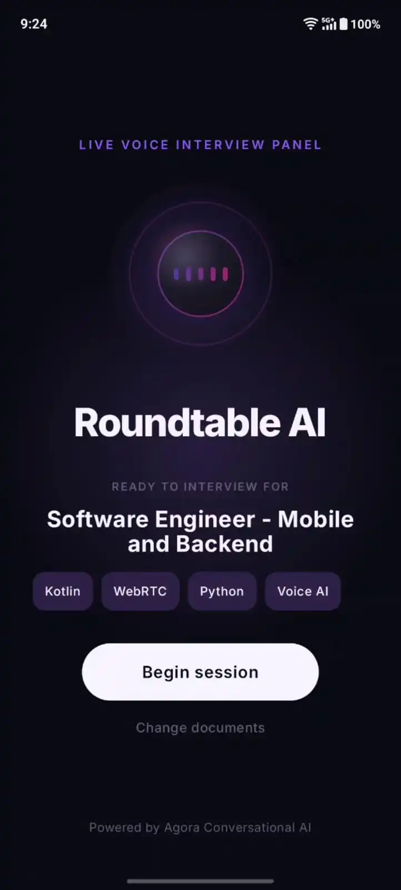
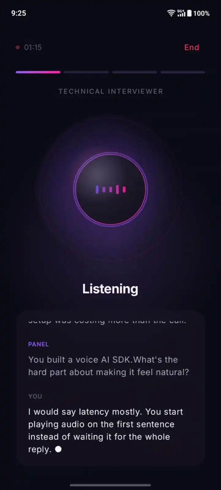
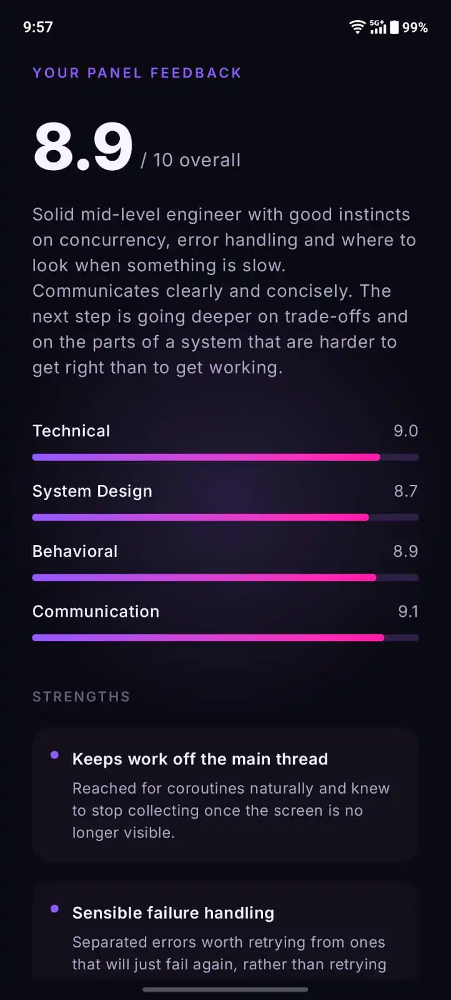

# Roundtable AI

**Upload a job description. Get interviewed by an AI panel over live voice. Walk away with a scored, evidence-backed evaluation.**

Roundtable AI is an Android app that runs a real job interview. You hand it the JD you're applying against, or just your resume, and three specialist interviewers take turns questioning you in real time: technical, system design, then behavioral. You can interrupt them mid-sentence. They remember what you said two rounds ago and bring it back up. When it's over, you get scores with quotes from your own answers as evidence.

---

## Demo

> **[▶ Watch a full interview in 4 minutes](https://youtu.be/vLGOhcjKvqk)**

| Panel ready | Live interview | Report |
| :---------: | :------------: | :----: |
|  |  |  |

---

## Why this isn't a voice chatbot with an interview prompt

The easy version of this project is one LLM told to "act like an interviewer." Here's what's actually different:

**The interview is built from your documents.** A Groq call parses your JD and resume into a structured profile: role, required skills, system design topics, responsibilities, resume highlights. Every question the panel asks is generated against *that* profile, so applying for an Android role and applying for a data engineering role produce genuinely different interviews.

**Three interviewers, and they share a memory.** When the System Design interviewer takes over, it's handed what you told the Technical interviewer. That means your exact words, plus the list of topics you already showed competence on. It's instructed to build on them rather than re-test them. So if you mention Kafka in round one, round two can open with *"Earlier you mentioned running Kafka in production. How would you handle message ordering as you scale consumers?"*

**Who speaks next is decided by code, not by an LLM.** Asking the model "is this round done?" every turn would add a round-trip to a live conversation and make the interview's shape a guess. The orchestrator tracks it directly: time spent in the round, how deep it has gone on the current topic, weak answers in a row. Rounds only move forward, so the interview always reaches the end.

**The panel adapts to how you're doing.** Answer a topic well and it digs into that topic instead of moving on, up to three follow-ups deep, then takes the next thing on the JD. Say "I've never used that" and it drops the topic straight away. Say it multiple times in a row and the round ends early.

**Each interviewer has a different voice.** Per-persona TTS voice IDs are pushed to Agora mid-session, so the handoff between rounds is something you *hear*, not just something the transcript claims.

---

## How it works

```
┌──────────────────────────────┐
│   Android app (Compose)      │
│   upload · voice · live      │         ┌──────────────────────────┐
│   transcript · report        │◄───────►│  Agora Conversational AI │
└──────────────┬───────────────┘  RTC    │  ASR ─ LLM ─ TTS ─ VAD   │
               │                  RTM    └────────────┬─────────────┘
               │ REST                                 │
               │                        custom LLM    │ transcripts,
               │                        callback      │ agent state
               ▼                                      ▼ (over RTM)
┌───────────────────────────────────────────────────────────────────┐
│                      FastAPI backend                              │
│                                                                   │
│   /jd/upload ──► Groq ──► InterviewProfile                        │
│   /session/start ──► mint tokens ──► start Agora agent            │
│   /chat/completions ◄── Agora calls this every single turn        │
│        │                                                          │
│        ├─ signals.py      which JD topics did that answer touch?  │
│        ├─ orchestrator.py which stage are we in? who speaks next? │
│        ├─ agents/         build that persona's system prompt      │
│        └─ Groq (streamed) ──► sanitized ──► back to Agora         │
│                                                                   │
│   /session/{ch}/report ──► background Groq call ──► scores        │
└───────────────────────────────────────────────────────────────────┘
```

Agora runs the conversation: microphone capture, speech recognition, voice activity detection, barge-in, and speech synthesis. The backend is registered as Agora's **custom LLM**, so every turn of the conversation comes to us as an OpenAI-shaped `/chat/completions` request. That's the hook the whole product hangs on. It's where we decide which interviewer is speaking and what they know.

### One turn, end to end

1. You finish speaking. Agora's VAD detects end-of-speech (semantic mode, 550ms silence window).
2. Agora transcribes and `POST`s the conversation to our `/chat/completions`.
3. `signals.py` scans your answer for JD keywords and low-engagement phrases. No LLM, just string matching.
4. `orchestrator.py` replays every answer so far through the stage rules and returns the current stage.
5. The matching persona builder assembles a system prompt: JD profile + prior-round quotes + topics you've already nailed.
6. That prompt replaces the system message. We stream Groq's reply back to Agora as SSE, sanitizing each chunk.
7. First chunk carries `custom_metadata` switching the TTS voice to this persona's.
8. Agora speaks it. Transcripts arrive on the phone over RTM and render live.

Steps 3 to 5 add no network calls. The only thing on the critical path is LLM.

### The stage machine

```
TECHNICAL ──► SYSTEM_DESIGN ──► BEHAVIORAL ──► FINAL_EVAL
```

Each round gets a time budget sized to what the round is worth, not an equal split:

| Round         | Budget       | Depth per topic |
| ------------- | ------------ | --------------- |
| Technical     | 15 to 20 min | 3 follow-ups    |
| System design | 10 to 15 min | 3 follow-ups    |
| Behavioral    | 5 to 7 min   | 2 follow-ups    |

The orchestrator holds one topic at a time and passes it into the persona's prompt, so the interviewer is told what to ask about rather than choosing for itself. It counts how deep the round has gone on that topic, and when the depth runs out the next uncovered item on the JD becomes the focus. If the candidate steers somewhere else on their own, whatever they actually talked about gets marked covered too, so the panel doesn't circle back to it later.

A full interview runs about 30 to 40 minutes. Turn counts are bounded on both sides, so a silent candidate can't skip a round in seconds and a talkative one can't run forever.

Current stage and topic are recalculated on every turn by replaying the answers in order, so the panel's state always matches what was actually said. The answers themselves are held by the backend, since a single request carries only recent history and a round measured in minutes needs to look further back.

### Cross-agent memory

Two things cross the round boundary:

- **Your exact words.** Up to 3 of your earlier answers, sampled *evenly* across the conversation rather than taking the most recent ones. A tail slice would drop your opening answers, and the claim worth calling back to is usually made early.
- **Demonstrated topics.** The strong-answer list the orchestrator already built for routing, reused rather than re-derived. The next persona is told what not to re-test.

---

## Reliability

Everything here exists because it broke during testing.

**The model needed deterministic guardrails.** llm might not reliably follow instructions, so each failure has a code-level backstop rather than firmer prompt wording:

| Failure                                                 | Backstop                                                          |
| ------------------------------------------------------- | ----------------------------------------------------------------- |
| Asks 4 questions in one turn                            | Response truncated after the 3rd question mark                    |
| Asks a question in its greeting                         | Opening line is buffered, questions stripped,*then* sent to TTS |
| Emits`reasoning`/`channel` deltas Agora can't parse | Stripped from every chunk before forwarding                       |
| Em dashes and curly quotes that TTS mispronounces       | Sanitized per chunk                                               |

**Failures degrade instead of dropping the call.** A Groq error becomes a spoken *"Sorry, could you say that again?"* rather than dead air. `httpx` doesn't raise on non-2xx and an error body isn't SSE-shaped, so unhandled it produced silence. If RTM login fails you lose live captions but the interview continues. If report generation fails, you get an honest failure state, not a spinner.

**Evaluation never blocks speech.** Scoring is `asyncio.create_task`'d the moment the interview reaches `FINAL_EVAL`. You hear the goodbye line immediately while the report generates behind it, and the app polls for it.

**Ending early still produces a real report.** Tap End at any point and whatever happened gets scored, with the prompt instructed to mark thin sections down rather than guess. Only a genuinely empty interview returns `not_applicable`.

**The report reads the full transcript.** Agora caps what it forwards to the custom LLM, so on a long interview the technical round has already scrolled out of the window by scoring time. The report fetches the complete conversation from Agora's history endpoint instead, falling back to the forwarded messages if that call fails.

---

## Agora integration

| Capability                         | Where it's used                                                                                                                       |
| ---------------------------------- | ------------------------------------------------------------------------------------------------------------------------------------- |
| **Conversational AI Engine** | Runs the interview. Backend is the custom LLM, called every turn.                                                                     |
| **Voice Calling (RTC)**      | The live audio session.`AUDIO_SCENARIO_AI_CLIENT`, AI echo cancellation loaded as an extension for barge-in over the phone speaker. |
| **Signaling (RTM)**          | Transcript and agent-state delivery, and per-turn ASR/LLM/TTS latency metrics.                                                        |
| **Agent client toolkit**     | `ConversationalAIAPIImpl` on Android for transcript and state events.                                                               |

Four settings are easy to miss on a first integration. Noting them here for anyone building on the same stack:

- `enable_rtm` belongs under `advanced_features`, not at the top level. The join succeeds either way, so it's worth double-checking the nesting.
- `parameters.data_channel` defaults to `datastream`. Set it to `"rtm"` to receive transcripts over Signaling, which is what the app renders from.
- `llm.output_modalities` should be `["text", "audio"]`, so the agent publishes both the spoken audio and the text events the live transcript is built from.
- The agent's token needs both RTC and RTM services in a single AccessToken2. With `enable_rtm` set, the agent reuses the `token` field for its RTM login rather than taking a second one.

Tokens are minted server-side only. The app ships no Agora credentials. It receives finished, channel-scoped tokens at runtime.

---

## Running it

**You need:** Android Studio, Python 3.11+, a physical Android device (emulator mic input is unreliable), an [Agora account](https://console.agora.io) with Conversational AI enabled, and a [Groq API key](https://console.groq.com/keys).

### Backend

```bash
cd backend
python -m venv .venv && source .venv/bin/activate   # Windows: .venv\Scripts\activate
pip install -r requirements.txt
cp .env.example .env        # then fill it in; each line says where to get the value
python -m uvicorn app.main:app --port 8000 --reload
```

Agora calls your backend mid-conversation, so it needs a public HTTPS URL:

```bash
ngrok http 8000
```

Put that URL in `.env` as `PUBLIC_BASE_URL`.

### Android app

Create `local.properties` in the project root (it's gitignored) and point it at the same tunnel:

```properties
backend.baseUrl=https://your-tunnel.ngrok-free.dev
```

Then run the app. Grant microphone permission, pick a JD or resume, tap **Analyze documents**, confirm the extracted role, and **Begin session**.

### API

| Endpoint                     | Purpose                                                                 |
| ---------------------------- | ----------------------------------------------------------------------- |
| `POST /jd/upload`          | PDF/DOCX → structured profile. Returns`profile_id`.                  |
| `POST /session/start`      | Mints tokens, starts the Agora agent, binds the profile to the channel. |
| `POST /chat/completions`   | **Agora calls this.** Persona routing and streaming happen here.  |
| `GET /session/{ch}/stage`  | Which interviewer is currently speaking.                                |
| `POST /session/{ch}/end`   | Triggers scoring for however far the interview got.                     |
| `GET /session/{ch}/report` | `pending` → `ready` \| `failed` \| `not_applicable`.           |

---

## Project layout

```
backend/app/
├── api/
│   ├── llm.py            custom-LLM endpoint: routing, streaming, TTS safeguards
│   ├── session.py        session lifecycle, tokens, agent start
│   └── jd.py             upload → profile
├── orchestration/
│   ├── orchestrator.py   the stage machine + cross-agent memory
│   └── signals.py        deterministic per-answer analysis
├── agents/               three persona builders + shared speech rules
├── evaluation/report.py  background scoring, evidence-backed
├── services/             Agora agent config, token minting, Groq, doc parsing
└── models/               InterviewProfile

app/src/main/java/com/techrifter/roundtableai/
├── interview/
│   ├── InterviewViewModel.kt   RTC + RTM + toolkit lifecycle, audio tuning
│   └── InterviewScreen.kt      pre-join / live / report, custom Canvas visualizer
└── network/SessionApi.kt       backend client
```

**Stack:** Kotlin · Jetpack Compose · Agora RTC 4.6.3 + RTM 2.3.0 · FastAPI · Pydantic · Groq (`gpt-oss-20b`) · Deepgram `nova-3` ASR · MiniMax `speech-2.8-turbo` TTS. minSdk 26.

---

## License

Code released under the [MIT License](https://github.com/techrifter/roundtableai/blob/main/LICENSE). Token generation under `backend/app/services/agora_access_token/` is vendored from [AgoraIO/Tools](https://github.com/AgoraIO/Tools) (MIT), with modifications noted in the file headers.
