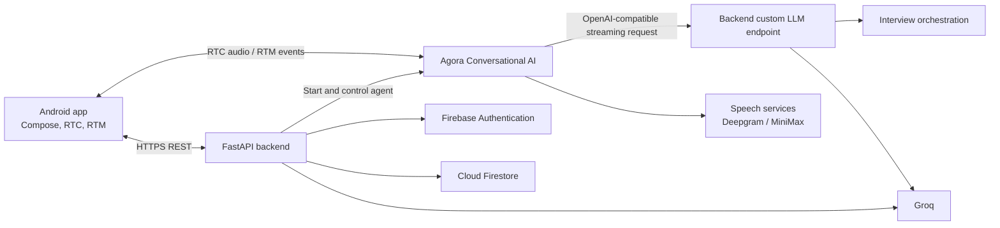

# Roundtable AI

Roundtable AI is an Android application for voice-based interview practice. Candidates can
provide a job description, a resume, or both; practice with a full interview panel or focus
on a technical or system-design skill; and review AI-generated feedback from the session.

## Product overview

- **Role-aware interviews:** Documents are parsed into a structured profile used to tailor
  interview questions.
- **Full mock interviews:** Practice technical, system-design, and behavioral topics in a
  live voice session.
- **Focused practice:** Rehearse a selected technical or system-design skill.
- **Live transcript:** Follow the conversation while speaking naturally and interrupting
  the interviewer.
- **Session feedback:** Review an evaluation informed by the interview conversation.

|                         Prepare                         |                         Interview                         |                        Feedback                        |
| :-----------------------------------------------------: | :-------------------------------------------------------: | :----------------------------------------------------: |
|  |  |  |

[Watch a full interview demonstration](https://youtu.be/vLGOhcjKvqk)

## Architecture



### Request and interview lifecycle

1. The Android app authenticates with Firebase and sends the user's Firebase ID token to
   authenticated backend endpoints.
2. The app uploads a job description and/or resume to `POST /jd/upload`. The backend
   extracts text, creates a structured interview profile, persists it, and returns a
   `profile_id`.
3. The app requests `POST /session/start`. The backend checks the user's interview
   allowance, creates a session, generates channel-scoped Agora tokens, and starts the
   Conversational AI agent.
4. During the live interview, Agora sends conversation turns to the backend's
   OpenAI-compatible `POST /chat/completions` endpoint. The orchestrator selects the
   interview stage and persona, then streams the generated response back to Agora.
5. Transcript and agent-state events are delivered to Android over RTM. The app polls
   session endpoints for stage and report status.
6. When the session ends, the backend generates a structured report and persists the
   result for the app to retrieve.

### Interview orchestration

The full interview progresses through technical, system-design, and behavioral stages.
Focused practice selects either the technical or system-design stage based on the chosen
skill. Backend orchestration applies stage and topic rules to the conversation and builds
the corresponding interviewer prompt. Reports include overall and category scores,
strengths, improvement areas, and a summary.

## Repository layout

```text
app/
  src/main/java/com/techrifter/roundtableai/
    auth/          Firebase authentication and sign-in UI
    interview/     Interview setup, live session, transcript, and report UI
    network/       Backend API client and response models
backend/
  app/
    api/           FastAPI route handlers
    agents/        Interview persona prompt builders
    orchestration/ Stage selection and answer/topic analysis
    evaluation/    Report generation and persistence
    services/      Document parsing, AI clients, Agora agent and token helpers
    static/        Privacy and account-deletion pages
    models/        Pydantic data models
  tests/           Backend unit tests
docs/
  screens/         Product screenshots
```

## API overview

Authenticated routes require a Firebase ID token in the `Authorization` header. The
Agora callback and public routes do not use app-user authentication.

| Method     | Path                               | Purpose                                                                 |
| :--------- | :--------------------------------- | :---------------------------------------------------------------------- |
| `GET`    | `/health`                        | Backend health response.                                                |
| `POST`   | `/jd/upload`                     | Parse a job description and/or resume; returns a profile.               |
| `GET`    | `/session/limits`                | Return the authenticated user's rolling 24-hour interview allowance.    |
| `POST`   | `/session/start`                 | Start a full or focused interview; returns Agora connection details.    |
| `GET`    | `/session/{channel_name}/stage`  | Retrieve the current interview stage.                                   |
| `GET`    | `/session/{channel_name}/report` | Retrieve report-generation status and report data.                      |
| `POST`   | `/session/{channel_name}/end`    | End the session and request its evaluation.                             |
| `POST`   | `/chat/completions`              | Agora custom-LLM callback; streams OpenAI-compatible response chunks.   |
| `POST`   | `/user/waitlist`                 | Add the authenticated user to the Pro early-access waitlist.            |
| `DELETE` | `/user/account`                  | Queue deletion of the authenticated user's account and associated data. |
| `GET`    | `/privacy`                       | Serve the privacy policy.                                               |
| `GET`    | `/account-deletion`              | Serve account-deletion instructions.                                    |

Interactive API documentation is available at `/docs` when the backend is running.

## Data and privacy

Firestore stores user-owned interview profiles and session records, including report
status and generated feedback. The service also uses Firestore for interview allowance,
waitlist, and account-deletion processing. Uploaded document files are processed to
extract an interview profile; the backend stores the extracted profile rather than an
archive of the original files. See the [Privacy Policy](https://sites.google.com/view/roundtableai-privacy-policy)
and [Account Deletion information](https://sites.google.com/view/roundtableai-deletion-policy)
for user-facing details.

Free accounts can start two interviews in a rolling 24-hour period. Document upload and
analysis do not count as an interview; starting one does.

## Technology

- **Android:** Kotlin, Jetpack Compose, AndroidX, Kotlin coroutines
- **Authentication:** Firebase Authentication
- **Backend:** Python 3.11+, FastAPI, Pydantic, Uvicorn
- **Persistence:** Cloud Firestore through Firebase Admin SDK
- **Voice:** Agora RTC, RTM, and Conversational AI
- **AI and speech:** Groq, Deepgram, and MiniMax

## Development setup

### Prerequisites

- Android Studio and an Android device or emulator with microphone support
- Python 3.11 or later
- Firebase project with Email/Password and Google Authentication enabled and Firestore
- Agora project with Conversational AI enabled
- Groq API key

### Backend

Create and activate a virtual environment, then install the backend dependencies.

**macOS/Linux**

```bash
cd backend
python3 -m venv .venv
source .venv/bin/activate
pip install -r requirements.txt
```

**Windows PowerShell**

```powershell
cd backend
py -3.11 -m venv .venv
.\.venv\Scripts\Activate.ps1
pip install -r requirements.txt
```

From the repository root, copy `backend/.env.example` to `backend/.env`:

```bash
cp backend/.env.example backend/.env
```

In PowerShell, use:

```powershell
Copy-Item backend\.env.example backend\.env
```

Then configure:

| Variable                          | Purpose                                                                 |
| :-------------------------------- | :---------------------------------------------------------------------- |
| `GROQ_API_KEY`                  | Groq API credential.                                                    |
| `GROQ_MODEL`                    | Model identifier used by profile, interview, and report generation.     |
| `AGORA_APP_ID`                  | Agora application identifier.                                           |
| `AGORA_APP_CERTIFICATE`         | Server-side Agora token-signing credential.                             |
| `AGORA_CUSTOMER_ID`             | Agora Conversational AI REST API credential.                            |
| `AGORA_CUSTOMER_SECRET`         | Agora Conversational AI REST API credential.                            |
| `PUBLIC_BASE_URL`               | Public HTTPS URL used by Agora to call the backend custom-LLM endpoint. |
| `FIREBASE_SERVICE_ACCOUNT_PATH` | Optional path to a local Firebase service-account JSON file.            |

Keep `.env` and service-account credentials out of version control. For Google Cloud
deployments, use the service identity and Application Default Credentials instead of
shipping a service-account key.

Run the backend from the `backend/` directory:

```bash
python -m uvicorn app.main:app --host 0.0.0.0 --port 8000 --reload
```

Agora must be able to reach `PUBLIC_BASE_URL` over HTTPS. For local development, expose
the backend through a secure tunnel and use that tunnel's URL.

### Android

1. Register the Android app in Firebase, enable the sign-in providers, configure signing
   fingerprints, and add the generated `google-services.json` to `app/`.
2. Create `local.properties` in the repository root:

   ```properties
   backend.baseUrl=https://your-backend.example.com
   ```
3. Open the project in Android Studio, sync Gradle, and run the `app` configuration.
   Grant microphone permission when prompted.

Gradle reads `backend.baseUrl` during the build and embeds it in `BuildConfig`. Set it to
the intended backend before building an APK or app bundle.

### Tests and builds

Run backend unit tests from the `backend/` directory:

```bash
python -m unittest discover -s tests
```

Build the Android debug variant from the repository root using the Gradle wrapper:

```bash
.\gradlew.bat :app:assembleDebug
```

On macOS/Linux, use `./gradlew :app:assembleDebug`.

## License

This project is released under the [MIT License](LICENSE). Agora access-token code under
`backend/app/services/agora_access_token/` is derived from
[AgoraIO/Tools](https://github.com/AgoraIO/Tools) and includes attribution in its source
files.
